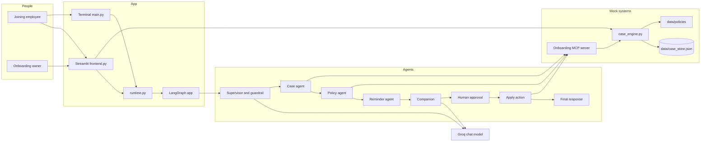
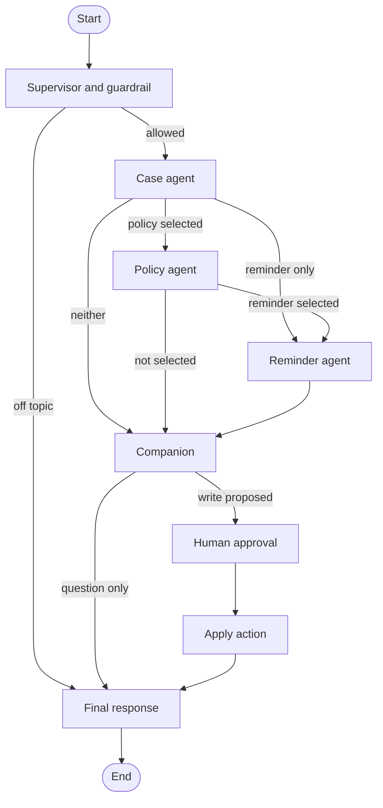
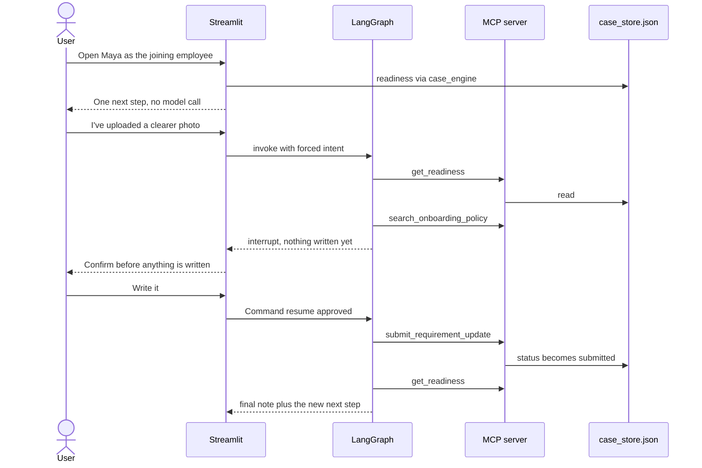
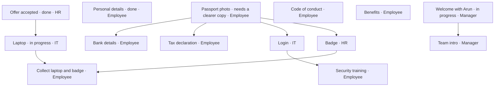

# Employee Onboarding Companion

## Technical design

| | |
|---|---|
| Project | Employee Onboarding Companion |
| Track | Employee Onboarding Companion: LangGraph, MCP, a supervisor guardrail, and human approval |
| Demo date inside the case file | 10 October 2026 |
| Model | Groq, `openai/gpt-oss-120b` |
| Interface | Streamlit, plus a small terminal entry point |

---

## 1. Project overview

### 1.1 Problem

Joining a company is a chain of small tasks split across the new hire, HR, IT, and the manager. Documents get submitted, sent back, and forgotten. Access waits on identity. Training waits on access. The new hire sees a pile of unrelated systems. The onboarding owner sees a checklist and still misses the one item that is actually blocking Day 1.

### 1.2 Track

This project is the **Employee Onboarding Companion** track. Specialist agents read a local MCP server that stands in for HR, documents, and access. A supervisor applies an input guardrail and routes the request. A human approval interrupt runs before any write.

The product choice is depth on one case file, not a wide HR portal. The screen shows one next step. The case file decides what that step is. The language model only phrases it.

### 1.3 Who it is for

| Reader | What they see |
|---|---|
| Joining employee | One action that is theirs, a short list of things that can wait, work already moving with IT or their manager, and the next meeting |
| Onboarding owner (HR) | Who is stuck across the people they own, and a single write (accept a document, issue a badge, or log a reminder) that waits for confirmation |

Two seeded people make the two phases concrete:

- **Maya Chen**, Product Designer, starts 20 October 2026. Today in the demo is 10 October, so she is ten days before Day 1. Her passport scan was cropped. Payroll, tax, login, and the badge stay closed until that photo is accepted. IT has already ordered the laptop. Her manager already has the welcome meeting.
- **Rohan Iyer**, Backend Engineer, started 6 October 2026. He is on Day 5. Documents, laptop, badge, and introductions are done. The only task that is his is a 20-minute security module, before a buddy coffee on Wednesday.

### 1.4 What the system knows

For each person the case file stores:

- which documents have been received, and which were sent back for a clearer copy
- which requirements are done, submitted, in progress, or not started
- which requirements are blocked, and by which earlier requirement
- who owns each step: employee, HR, IT, or manager
- meetings from today forward
- reminders already logged on the demo date
- the handbook passage that matches the current step

### 1.5 What was left out on purpose

Real HR, document storage, and IT access systems are mocked. There is no email gateway, no login, and no third employee. A reminder is written into the case file after a person confirms it. It is not sent to an inbox. That keeps the design on orchestration quality: dependencies, owners, exceptions, and the next honest action.

---

## 2. System architecture

### 2.1 Context



The Streamlit page reads the case file directly so the first screen is instant. Questions and button actions go through the graph, and the graph reaches the same file only through MCP tools. The screen can show state immediately, and the agents still have to call tools.

### 2.2 Agent graph



Routing functions live in `graph.py`:

| Function | Decision |
|---|---|
| `route_from_supervisor` | Guardrail failure skips every tool and goes to the final response |
| `route_after_case` | Policy agent, else reminder agent, else companion |
| `route_after_policy` | Reminder agent if it was selected, else companion |
| `route_after_companion` | Human approval only when `proposed_action.needs_approval` is true |

The reminder agent always continues to the companion. There is no path that ends on a specialist.

### 2.3 Read path and write path



A question such as "What should I do before Monday?" follows the same agents and stops at the final response. It does not interrupt.

### 2.4 Maya's dependency chain



Conduct and benefits have no dependencies. They are visible as "when you have a moment," but they are not the next step while the passport is blocking four other items.

After the employee submits a clearer photo, the passport moves to `submitted` and HR's next step becomes accepting it. After HR accepts it, HR's own next step becomes issuing the badge, and IT's login is unblocked. The employee still has the code of conduct, which is due sooner and does not depend on identity.

### 2.5 Component map

| File | Role |
|---|---|
| `frontend.py` | Employee view, owner portfolio, ask box, approval card |
| `main.py` | One-shot terminal question, with a yes/no prompt if a write is proposed |
| `runtime.py` | `ask` and `resume` around the compiled graph |
| `graph.py` | State graph, conditional edges, checkpointer |
| `agents.py` | Supervisor, specialists, approval, apply, final text |
| `state.py` | `OnboardingState` |
| `mcp_client.py` | Stdio MCP client. Spawns the server with the current Python |
| `servers/onboarding_mcp_server.py` | Mock HR, documents, access, and handbook tools |
| `case_engine.py` | Rules: readiness, dependencies, owners, reminders, policy search |
| `data/policies/*.md` | Short handbook pages |
| `data/case_store.json` | Live case file, created from the seed on first read |
| `config.py` | Groq client and environment loading |
| `tests/test_case_engine.py` | Rules, with no model and no MCP |
| `tests/test_graph.py` | Approval interrupt and the guardrail, through MCP |

### 2.6 State

`OnboardingState` in `state.py` is a `TypedDict`. Most fields are replaced by the latest node. `messages` and `trace` use `operator.add`, so each node appends.

| Group | Fields |
|---|---|
| Input | `user_query`, `viewer_role`, `employee_id`, `user_id`, optional `forced_intent`, `forced_requirement_id` |
| Routing | `guardrail_passed`, `intent`, `target_requirement_id`, `selected_agents`, `supervisor_reasoning` |
| Evidence | `case_snapshot`, `policy_context`, `reminder_plan` |
| Proposal | `proposed_action`, `companion_message`, `approval_request` |
| After a person decides | `approved`, `human_feedback`, `action_result`, `final_response`, `llm_calls` |

`intent` is one of `ask`, `submit_update`, `complete_task`, or `send_reminder`.

### 2.7 Checkpointing

Human approval uses LangGraph `interrupt`. That requires a checkpointer, because the process stops inside `human_approval` and later continues with `Command(resume=...)` on the same `thread_id`.

The configured database is Postgres:

`postgresql://gulshan37.kumar@localhost:5432/onboarding_companion`

`graph.py` reads `ONBOARDING_DATABASE_URL` and uses `PostgresSaver`. If that server cannot be reached, it falls back to `MemorySaver` for the current process and prints the reason. An approval can then be resumed only until the process stops.

---

## 3. Setup and deployment

### 3.1 Requirements

- Python 3.12
- Network access to Groq for free-text answers
- No database for the default run
- macOS with the system trust store, if traffic is inspected by a proxy such as Zscaler

### 3.2 Local run

```bash
cd Employee_Onboarding_Companion
python3.12 -m venv .venv
source .venv/bin/activate
pip install -r requirements.txt
cp .env.example .env
```

Edit `.env`:

```text
GROQ_API_KEY=your_groq_api_key
GROQ_MODEL=openai/gpt-oss-120b
```

The project `.env` overrides any key already in the environment. Button actions and the case screen work with no key. Free-text routing then uses keyword rules, and the reply is the case brief with no rewrite.

Start the app:

```bash
streamlit run frontend.py
```

Terminal form:

```bash
python main.py --role employee --employee maya "What should I do before Monday?"
python main.py --role hr --employee maya "Remind Maya about the passport"
```

Tests:

```bash
python -m unittest tests.test_case_engine tests.test_graph
```

`tests/test_case_engine.py` sets `ONBOARDING_STORE_PATH` to a temporary file before import, so the tests do not change the demo store. `tests/test_graph.py` does the same and drives the real MCP server.

### 3.3 How to use the running app

1. Sidebar: **Joining** or **Onboarding owner**.
2. As the employee, choose Maya or Rohan. The hero card is the one next step.
3. The primary button starts a graph run with `forced_intent` set, so the click does not depend on the model guessing the requirement.
4. The page stops on **Confirm before anything is written**. **Write it** resumes the graph and updates the file. **Leave it** resumes with `approved: false` and changes nothing.
5. The ask box is for questions. Requests that are not about joining stop at the guardrail.
6. **Reset demo stories** rewrites `data/case_store.json` from the seed in `case_engine.py`.
7. **How this was decided** shows the supervisor reason, the agent trace, and the model-call count.

### 3.4 Postgres checkpoints

`.env` sets:

```text
ONBOARDING_DATABASE_URL=postgresql://gulshan37.kumar@localhost:5432/onboarding_companion
```

That is the Homebrew server already listening on port 5432. Case rows live in `employees`, `requirements`, `meetings`, `reminders`, and `events`. The first graph startup also calls `PostgresSaver.setup()`, which creates `checkpoints`, `checkpoint_blobs`, `checkpoint_writes`, and `checkpoint_migrations`. Each browser thread id then survives a process restart. The checkpoint connection uses autocommit so that setup can create its indexes.

This app is a single Python process. Streamlit, the graph, and the MCP stdio child all run on one machine. There is no separate web server, container, or worker queue in this design.

### 3.5 Process layout at runtime

```text
streamlit run frontend.py
    └── imports graph.app
            └── PostgresSaver (MemorySaver only if Postgres is down)
    └── on the first tool call, mcp_client starts:
            python servers/onboarding_mcp_server.py   (stdio)
                    └── case_engine reads and writes data/case_store.json
```

`mcp_client.py` passes `ONBOARDING_ROOT` and, when set, `ONBOARDING_STORE_PATH` into the child. The server adds the project root to `sys.path` and imports `case_engine`. Tool discovery is cached for the life of the Streamlit process.

### 3.6 Environment variables

| Variable | Required | Meaning |
|---|---|---|
| `GROQ_API_KEY` | For free-text phrasing | Groq key. Loaded from this project's `.env` first |
| `GROQ_MODEL` | No | Defaults to `openai/gpt-oss-120b` |
| `ONBOARDING_DATABASE_URL` | Yes | `postgresql://gulshan37.kumar@localhost:5432/onboarding_companion` |
| `ONBOARDING_STORE_PATH` | No | Override the case JSON path. Tests set this |
| `ONBOARDING_ROOT` | No | Set by the MCP client for the child process |

`truststore.inject_into_ssl()` runs before the Groq client is created. On this machine, Groq is reached through a Zscaler certificate that the Mac trust store accepts and Python's default bundle does not.

### 3.7 Dependencies

| Package | Why it is here |
|---|---|
| `langgraph` | State graph, conditional edges, interrupt |
| `langgraph-checkpoint-postgres`, `psycopg` | Optional durable threads |
| `langchain-core`, `langchain-groq` | Messages and the Groq chat model |
| `mcp`, `langchain-mcp-adapters` | Local stdio MCP server and client |
| `streamlit` | The companion screen |
| `python-dotenv` | `.env` loading |
| `truststore` | Use the operating-system certificate store |

---

## 4. Code explanation

### 4.1 `case_engine.py` — the rules

This module is the source of truth. Agents are not allowed to invent a task that the engine did not compute.

The seed is a function, `seed()`, so a reset is a deep copy and not a mutation of a shared dict. `load_store()` creates `data/case_store.json` on first read. `save_store()` writes a temporary file and replaces the real file.

A requirement looks like this:

| Field | Meaning |
|---|---|
| `id` | Stable id, for example `identity_proof` |
| `owner` | `employee`, `hr`, `it`, or `manager` |
| `status` | `not_started`, `needs_clarification`, `submitted`, `in_progress`, `done`, `waived` |
| `depends_on` | Ids that must be `done` or `waived` before this one is ready |
| `due` | `YYYY-MM-DD`, or empty |
| `review` | When true, the employee may submit it, and only HR may mark it done |
| `policy_topic` | Handbook topic used by search |
| `document` | Filename, date received, and the review note when a photo was sent back |

`readiness(employee_id, viewer_role)` returns one snapshot:

- `next` — the single focus requirement for this viewer
- `next_reason` and `unlocks` — why it matters
- `action` — the one button, or none
- `also_ready` — other employee tasks that can wait
- `in_motion` — `in_progress` work owned by someone else
- `later` — blocked items and what they are waiting on
- `upcoming` — meetings on or after the demo date
- `urgency` — `now`, `soon`, or `clear`
- `headline` — one sentence for the screen

Queue order for the employee:

1. Their own item in `needs_clarification`
2. Their own item that is `not_started` and whose dependencies are satisfied, earliest due date first

Queue order for HR:

1. Anything `submitted` and waiting for review
2. Anything in `needs_clarification`
3. Overdue work
4. HR-owned work whose dependencies are met
5. Someone else's work due within three days

`in_progress` and `submitted` are not "ready." A dependency is satisfied only by `done` or `waived`. A cropped passport therefore blocks bank details even though a file is already on record.

Writes:

| Function | Effect | Who may do it |
|---|---|---|
| `submit_update` | Sets `submitted`, stores the received date, clears the review note | Employee, for their own items, or HR |
| `complete_requirement` | Sets `done` if dependencies are met | The owner, or HR. A `review` item can be closed only by HR. A `submitted` item can be closed only by HR |
| `log_reminder` | Appends a reminder dated the demo "today" | After human approval. A second reminder for the same item on the same day removes the button and changes the headline |

`search_policy` scores handbook files by token overlap and by an exact topic hit. It returns the title, topic, excerpt, and a truncated body. There is no vector index.

`narrative()` turns a snapshot into the brief the model is allowed to rewrite. `portfolio()` sorts every person by urgency so Maya, who is blocked now, stays above Rohan, who only has a task due this week.

### 4.2 MCP server

`servers/onboarding_mcp_server.py` is a `FastMCP` stdio server. Each tool is a thin wrapper:

| Tool | Engine call |
|---|---|
| `get_employee_case` | `get_case` |
| `get_readiness` | `readiness`, or `portfolio` when the id is `all` |
| `list_onboarding_cases` | `list_cases` |
| `search_onboarding_policy` | `search_policy` |
| `submit_requirement_update` | `submit_update` |
| `complete_onboarding_requirement` | `complete_requirement` |
| `log_onboarding_reminder` | `log_reminder` |
| `reset_demo_data` | `reset_store` |

The UI reset button calls `reset_store()` in-process. The MCP tool exists so an agent could reset the demo the same way. The running server re-reads the JSON on every call, so an in-process reset is visible to the next tool call.

### 4.3 Agents

**Supervisor** (`supervisor_agent`)

- If the UI set `forced_intent`, it accepts the action and does not call the model. Button clicks use this path.
- Otherwise it asks the model for JSON: allowed or not, intent, requirement hint, focus employee, selected agents, and a reason.
- If the model call fails, `_fallback_route` uses keyword lists. Travel, poems, and similar phrases are rejected. Words such as "uploaded" or "remind" choose the intent. "passport" maps to `identity_proof`.
- A requirement hint is kept only when it is a real id for that person.
- `case_agent` is always selected on an allowed request.

**Case agent** calls `get_readiness` and stores the snapshot. It does not call the model.

**Policy agent** searches with the next step's topic plus the user question.

**Reminder agent** reads the snapshot's proposed action. It records whether a reminder is due, already logged, or irrelevant. It does not send anything.

**Companion** builds `proposed_action`.

- `ask` sets `needs_approval` false.
- `submit_update`, `complete_task`, and `send_reminder` set `needs_approval` true.
- If the user named a specific requirement, that id is carried through and the engine may still reject it.
- For a question, the model may rewrite `narrative()` in under 140 words and may not add tasks, dates, or owners. If there is no key, or the call fails, the brief is shown as written.
- For a write, the message only says that nothing is stored until the person confirms.

**Human approval** calls `interrupt(...)` with the title, detail, and action. On resume it stores `approved` and `human_feedback`. LangGraph restarts the node; `interrupt` returns the resume payload on the second pass.

**Apply action** runs only after approval.

- Declined: `action_result.skipped`, file unchanged.
- Approved: the matching MCP write, then a fresh `get_readiness`.

**Final response**

- Guardrail failure: the rejection text.
- Skipped write: "Nothing was written."
- Successful write: "That's recorded." plus a new narrative from the refreshed snapshot.
- Question: the companion message.

### 4.4 Frontend

`frontend.py` keeps `role`, `employee_id`, `thread_id`, and the latest graph result in `st.session_state`.

The employee page is a phase line, one hero card, optional quieter tasks, work already in motion, and three upcoming meetings. The owner page lists people by urgency. **Open** switches into that person's case.

While an interrupt is waiting, the primary action and the ask button are disabled so a second run cannot start on the same thread.

### 4.5 Handbook

| File | Topic | Used when |
|---|---|---|
| `identity.md` | identity | Passport photo, including the four-corners rule |
| `payroll.md` | payroll | Bank details and tax, after identity is accepted |
| `benefits.md` | benefits | Enrolment before the walkthrough |
| `equipment.md` | equipment | Laptop, login, badge, collection |
| `conduct.md` | conduct | Acknowledgement that blocks nothing else |
| `security.md` | security | Rohan's first-week module |
| `first_week.md` | first_week | Day 1 shape and the buddy coffee |

---

## 5. Assumptions

1. **The demo clock is 10 October 2026.** Due dates, "today" reminders, and "ten days before Day 1" are computed from `as_of` in the case file, not from the wall clock. That keeps Maya and Rohan stable.
2. **Two employees are enough.** Maya is the blocked pre-joining case. Rohan is the quiet first week. The owner view is the comparison.
3. **HR is the onboarding owner.** IT and the manager appear as owners on requirements. They do not have separate logins. HR can close another owner's step when recording that the work happened, such as accepting a document.
4. **A cropped document is not done.** `needs_clarification` and `submitted` do not satisfy dependencies.
5. **Review items cannot be self-certified.** Identity, bank details, and tax have `review: true`. The employee submits them. Only HR marks them done. The code of conduct and security training can be marked done by the employee, because nothing legal is being accepted.
6. **One reminder per item per demo day.** A second nudge the same day is refused by the queue, not by deleting the underlying problem.
7. **The model does not choose the next task.** It may phrase the brief. Button actions pass `forced_intent` and `forced_requirement_id` so a click cannot be routed to the wrong requirement.
8. **Off-topic input is refused.** The guardrail is the model when a key exists, and a keyword list when it does not. A rejected request never calls MCP.
9. **Writes are not real side effects.** No email, badge printer, or payroll API is called. "Remind" means "store an approved reminder on the case."
10. **The handbook is local markdown.** Search is keyword overlap. It will miss a paraphrase that shares no tokens with the page.
11. **The case file is a single JSON document.** Concurrent edits from two processes can race. That is acceptable for one Streamlit process and one MCP child.
12. **Cases and approvals are stored in Postgres** on `localhost:5432`, database `onboarding_companion`. If that server is down, the app uses the JSON case file and in-memory checkpoints.
13. **The Groq model is `openai/gpt-oss-120b`.** That is the chat model configured for this app.
14. **TLS uses the OS trust store** via `truststore`, because the network path presents a Zscaler certificate.
15. **Names, documents, and handbook text are fictional** and written for this demo.

---

## 6. Worked examples

### Maya asks what to do

Supervisor allows the question, intent `ask`. The case agent returns the passport as `next`, with bank details, tax, login, and the badge in `unlocks`. The policy agent returns the identity page: all four corners of the bio page must be visible. The reminder agent notes that the next step is work, not a nudge. The companion rewrites that brief. No interrupt.

### Maya records a clearer photo

The button sets `forced_intent=submit_update` and `forced_requirement_id=identity_proof`. The graph proposes the write and interrupts. Until **Write it**, status stays `needs_clarification`. After approval, status becomes `submitted`. The employee's next step becomes the code of conduct. HR's next step becomes accepting the passport.

### HR accepts the passport

`complete_requirement` with actor `hr` sets identity to `done`. Bank details and tax become ready for Maya. The login becomes ready for IT. HR's own next ready step is the badge, which depended on identity.

### Someone asks something unrelated to joining

The guardrail sets `guardrail_passed` false. The graph goes straight to the final response. The case file is not opened.

---

## 7. Tests

| Test | What it locks |
|---|---|
| Maya's next step is the passport, and bank details are later | Dependency priority |
| Submitting the photo moves Maya to the code of conduct and HR to review | Status change |
| HR acceptance unlocks the badge for HR | Owner-specific next step |
| The employee cannot close a review document or IT's laptop | Authorization |
| A reminder logged today removes the button but keeps the document open | Same-day nudge rule |
| Rohan's only step is security training, then the case is clear | Week-one story |
| The portfolio lists Maya before Rohan | Owner sorting |
| "passport photo" search hits the four-corners rule | Handbook retrieval |
| A button write interrupts, a decline writes nothing, an approval updates the file | Graph and MCP |
| An unrelated question fails the guardrail | Input guardrail |
